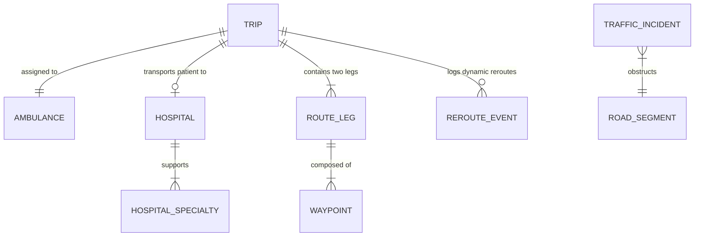

# RescuePath: Data Models & Database Schemas
**Document Version:** 1.0.0  
**Project Title:** RescuePath: Adaptive Ambulance Routing with Real-Time Decision Support  
**Primary Engine:** MongoDB Atlas (Mongoose ODM)  
**Development Fallback:** Local In-Memory & JSON Data Store  

---

## 1. Entity-Relationship & Domain Model



---

## 2. Detailed Schemas

### 2.1 Trip Mission Schema (`trips`)

Represents the core two-leg emergency mission from initial dispatch through patient delivery and post-trip auditing.

```typescript
interface ICoordinates {
  name: string;
  lat: number;
  lng: number;
}

interface IRouteInstruction {
  instruction: string;
  distanceMeters: number;
  maneuver?: string;
}

interface IRouteSegment {
  fromNode: string;
  toNode: string;
  roadName: string;
  lengthMeters: number;
  speedKmh: number;
  freeFlowSpeedKmh: number;
  congestionLevel: "CLEAR" | "MODERATE" | "CONGESTED";
}

interface IRouteLeg {
  description: string;
  distanceKm: number;
  estimatedDurationMinutes: number;
  actualDurationMinutes?: number;
  trafficDelayMinutes: number;
  congestionLevel: "CLEAR" | "MODERATE" | "CONGESTED";
  waypoints: [number, number][]; // [lat, lng] tuples
  instructions: IRouteInstruction[];
  segments?: IRouteSegment[];
}

interface IRerouteEvent {
  rerouteId: string;
  timestamp: string;
  triggerReason: string;
  timeSavedMinutes: number;
  previousEtaMinutes: number;
  newEtaMinutes: number;
  acceptedByDriver: boolean;
}

interface ICandidateHospitalEvaluation {
  hospitalId: string;
  hospitalName: string;
  distanceKm: number;
  travelTimeMinutes: number;
  suitabilityScore: number;
  icuBedsAvailable: number;
  erBedsAvailable: number;
  hasMatchingSpecialty: boolean;
  recommended: boolean;
}

interface ITrip {
  id: string; // e.g. "TRIP-2026-0042"
  emergencyType: "Cardiac Arrest" | "Severe Trauma" | "Stroke" | "Respiratory Distress" | "Obstetric" | "General";
  severity: "CRITICAL" | "HIGH" | "MODERATE" | "LOW";
  status: "DISPATCHED" | "EN_ROUTE_TO_PATIENT" | "AT_PATIENT_LOCATION" | "EN_ROUTE_TO_HOSPITAL" | "ARRIVED_AT_HOSPITAL" | "COMPLETED" | "CANCELLED";
  callerNotes?: string;
  
  // Mandatory 3 locations
  ambulanceLocation: ICoordinates;
  patientLocation: ICoordinates;
  selectedHospital?: {
    id: string;
    name: string;
    lat: number;
    lng: number;
    travelTimeMinutes: number;
    distanceKm: number;
  };
  
  // Mandatory 2 route legs
  leg1: IRouteLeg; // Ambulance -> Patient
  leg2?: IRouteLeg; // Patient -> Hospital

  // Decision support & rerouting
  candidateHospitals: ICandidateHospitalEvaluation[];
  rerouteHistory: IRerouteEvent[];
  
  // Performance & audit metrics
  timestamps: {
    dispatchedAt: string;
    arrivedAtPatientAt?: string;
    departedPatientAt?: string;
    arrivedAtHospitalAt?: string;
    completedAt?: string;
  };
  metrics?: {
    totalEstimatedMinutes: number;
    totalActualMinutes: number;
    durationVarianceMinutes: number;
    routeEfficiencyScore: number; // Ratio of free-flow ideal time to actual time
    goldenHourCompliant: boolean;
  };
}
```

---

### 2.2 Hospital Registry Schema (`hospitals`)

Stores hospital clinical capabilities, ICU/ER bed real-time capacity, and trauma designations.

```typescript
interface IHospital {
  id: string; // e.g. "HOSP-001"
  name: string;
  address: string;
  location: {
    type: "Point";
    coordinates: [number, number]; // [lng, lat] for GeoJSON 2dsphere indexing
  };
  contactPhone: string;
  traumaLevel: "LEVEL_1" | "LEVEL_2" | "LEVEL_3" | "GENERAL";
  capacity: {
    totalEmergencyBeds: number;
    availableEmergencyBeds: number;
    totalIcuBeds: number;
    availableIcuBeds: number;
    status: "OPEN" | "BUSY" | "CRITICAL_CAPACITY" | "DIVERT";
  };
  specialties: {
    cardiology: boolean;
    traumaSurgery: boolean;
    neurologyStroke: boolean;
    pediatricEmergency: boolean;
    burnCare: boolean;
    cathLabAvailable: boolean;
  };
  rating: number;
}
```

---

### 2.3 Ambulance Fleet Unit Schema (`ambulances`)

```typescript
interface IAmbulance {
  id: string; // e.g. "AMB-KA01-108"
  callSign: string;
  licensePlate: string;
  type: "ADVANCED_LIFE_SUPPORT" | "BASIC_LIFE_SUPPORT" | "NEONATAL";
  currentStatus: "AVAILABLE" | "DISPATCHED" | "IN_TRANSIT" | "MAINTENANCE";
  currentLocation: {
    lat: number;
    lng: number;
    lastUpdated: string;
  };
  assignedTripId?: string;
}
```

---

### 2.4 Traffic Incident & Congestion Schema (`traffic_incidents`)

```typescript
interface ITrafficIncident {
  id: string;
  roadName: string;
  location: {
    lat: number;
    lng: number;
  };
  severity: "LOW" | "MODERATE" | "HEAVY_CONGESTION" | "COMPLETE_BLOCK";
  delayFactor: number; // 1.0 (free flow) to 4.5 (severe bottleneck)
  speedKmh: number;
  description: string;
  active: boolean;
  reportedAt: string;
  clearedAt?: string;
}
```

---

### 2.5 Road Network Graph Seed Schema

Defines the structure of the pre-loaded topological graph loaded into NetworkX:

```json
{
  "graphId": "bengaluru-corridor-v1",
  "description": "Bengaluru East-Central Emergency Transit Network (MG Road - Indiranagar - Whitefield)",
  "nodes": [
    { "id": "N-101", "name": "MG Road Metro Station", "lat": 12.9756, "lng": 77.6066 },
    { "id": "N-102", "name": "Trinity Circle", "lat": 12.9729, "lng": 77.6174 },
    { "id": "N-103", "name": "Halasuru Police Station", "lat": 12.9772, "lng": 77.6254 },
    { "id": "N-104", "name": "Indiranagar 100ft Rd / CMH Junction", "lat": 12.9784, "lng": 77.6408 },
    { "id": "N-105", "name": "Domlur Flyover", "lat": 12.9608, "lng": 77.6415 },
    { "id": "N-106", "name": "Manipal Hospital Entrance", "lat": 12.9592, "lng": 77.6534 },
    { "id": "N-107", "name": "Marathahalli Bridge", "lat": 12.9562, "lng": 77.7011 },
    { "id": "N-108", "name": "Whitefield City Care Junction", "lat": 12.9698, "lng": 77.7499 }
  ],
  "edges": [
    { "from": "N-101", "to": "N-102", "roadName": "MG Road", "lengthMeters": 1300, "freeFlowSpeedKmh": 45, "lanes": 3 },
    { "from": "N-102", "to": "N-103", "roadName": "Old Madras Road", "lengthMeters": 1100, "freeFlowSpeedKmh": 40, "lanes": 2 },
    { "from": "N-103", "to": "N-104", "roadName": "CMH Road", "lengthMeters": 1800, "freeFlowSpeedKmh": 35, "lanes": 2 },
    { "from": "N-104", "to": "N-105", "roadName": "100 Feet Road", "lengthMeters": 2100, "freeFlowSpeedKmh": 45, "lanes": 3 },
    { "from": "N-105", "to": "N-106", "roadName": "Old Airport Road", "lengthMeters": 1400, "freeFlowSpeedKmh": 50, "lanes": 3 },
    { "from": "N-106", "to": "N-107", "roadName": "HAL Old Airport Corridor", "lengthMeters": 5200, "freeFlowSpeedKmh": 50, "lanes": 3 },
    { "from": "N-107", "to": "N-108", "roadName": "Varthur Main Road", "lengthMeters": 5800, "freeFlowSpeedKmh": 45, "lanes": 2 }
  ]
}
```

---

## 3. Database Indexes

To achieve sub-second spatial queries and fast dashboard aggregations:

```javascript
// Geospatial index for nearby hospital discovery
HospitalSchema.index({ "location": "2dsphere" });

// Trip status and timeline indices for dashboard queries
TripSchema.index({ "status": 1, "createdAt": -1 });
TripSchema.index({ "emergencyType": 1 });
TripSchema.index({ "timestamps.dispatchedAt": -1 });

// Incident active status index
TrafficIncidentSchema.index({ "active": 1 });
```
