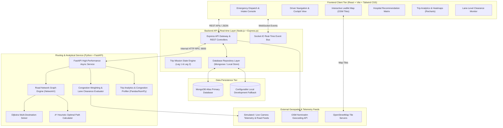
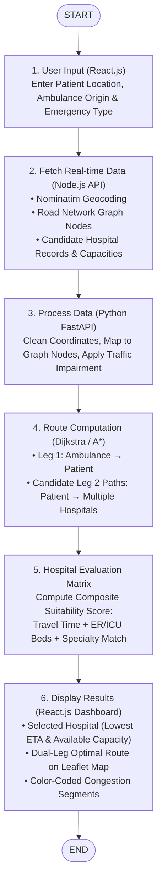
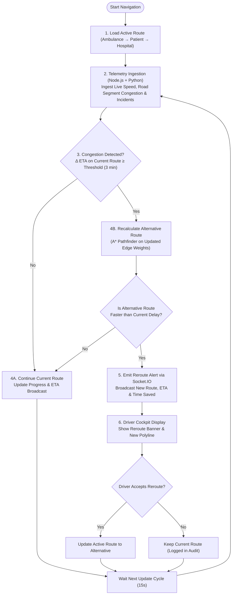
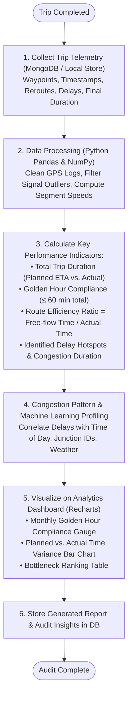

# RescuePath: System Architecture & Design Specification
**Document Version:** 1.0.0  
**Project Title:** RescuePath: Adaptive Ambulance Routing with Real-Time Decision Support  
**Institution:** Department of Computer Science & Engineering, GM Institute of Technology (GMIT), Davanagere  
**Affiliation:** Visvesvaraya Technological University (VTU), Belagavi  
**Authors:** Madhushree N, Dhanya S V, Deepa C M, Padmavati S A  
**Guide:** Dr. Chethan Chandra S Basavaraddi  

---

## 1. Architectural Overview & System Decomposition

RescuePath is architected as a distributed, service-oriented system designed for real-time responsiveness, algorithmic rigor, and robust failover. The platform decouples user interaction, real-time message brokering, business workflow orchestration, and geospatial graph computation into dedicated tiers.



---

## 2. Component Design & Responsibility Matrix

### 2.1 Frontend Client Tier (React.js + Vite + Tailwind CSS)
- **Role:** Delivers a zero-latency, reactive single-page application (SPA) optimized for emergency dispatchers and in-vehicle ambulance tablets.
- **Key Modules:**
  - `MapComponent.tsx`: Interactive Leaflet map supporting multi-marker rendering (Ambulance, Patient, Candidate Hospitals), color-coded route polylines (Green/Amber/Red based on live congestion), turn arrows, and lane guidance overlays.
  - `EmergencyIntakeModal.tsx`: Fast intake form with address geocoding, patient severity classification, and emergency type matching.
  - `DriverCockpit.tsx`: Ergonomic, high-contrast console displaying next-turn instruction, distance to target, remaining ETA, real-time speed, lane clearance alerts, and instant reroute prompts.
  - `HospitalDecisionMatrix.tsx`: Comparative table and cards sorting candidate hospitals by live ETA, ICU/emergency bed availability, and specialized facilities.
  - `AnalyticsDashboard.tsx`: Interactive Recharts dashboard visualizing Golden Hour compliance, planned vs. actual transit durations, route efficiency scores, and recurring congestion heatmaps.
  - `LaneLevelVisionCard.tsx`: Visualizer displaying lane occupancy percentages and emergency shoulder status.

### 2.2 Backend Gateway & Orchestrator (Node.js + Express.js)
- **Role:** Handles authentication, API routing, business validations, persistence adapters, and bi-directional WebSocket broadcasting.
- **Key Subsystems:**
  - `TripController`: Manages lifecycle transitions: `DISPATCHED` $\rightarrow$ `EN_ROUTE_TO_PATIENT` $\rightarrow$ `AT_PATIENT_LOCATION` $\rightarrow$ `EN_ROUTE_TO_HOSPITAL` $\rightarrow$ `ARRIVED_AT_HOSPITAL` $\rightarrow$ `COMPLETED`.
  - `SocketService`: Manages WebSocket channels (`trip:join`, `trip:location_update`, `trip:reroute_alert`, `trip:traffic_change`, `trip:status_change`).
  - `HospitalController`: Manages hospital discovery, bed capacity updates, and specialty attributes.
  - `RoutingProxy`: Forwards complex routing, multi-destination queries, and dynamic reroute evaluations to the Python FastAPI engine over high-speed HTTP RPC.
  - `StorageAdapter`: Hybrid persistence layer that connects to MongoDB Atlas using Mongoose, automatically falling back to an in-memory/file-based local database if network or credentials are absent.

### 2.3 Geospatial Routing & Analytical Engine (Python + FastAPI)
- **Role:** High-performance mathematical computation, graph algorithm execution, traffic impedance weighting, and geospatial analytics.
- **Key Components:**
  - `RoadNetworkGraph`: Graph model $G=(V, E)$ constructed using NetworkX. Nodes represent road junctions and coordinate centroids; edges represent road links with physical attributes (length, lanes, speed limit, road classification).
  - `DijkstraSolver`: Single-source shortest path implementation used to evaluate costs from the patient pickup node to all candidate hospital destination nodes simultaneously.
  - `AStarSolver`: Goal-directed $A^*$ pathfinding using great-circle Haversine distance heuristic:
    $$f(n) = g(n) + h(n)$$
    $$h(n) = R \cdot c = 2R \arcsin\left(\sqrt{\sin^2\left(\frac{\Delta \phi}{2}\right) + \cos \phi_1 \cos \phi_2 \sin^2\left(\frac{\Delta \lambda}{2}\right)}\right)$$
    guaranteeing admissibility and minimal node expansion during rapid reroute recalculations.
  - `DynamicTrafficModel`: Computes edge impedance $W(e, t)$ based on base travel time, real-time congestion factor $C \in [1.0, 4.5]$, lane availability factor $L$, and intersection delay $D$.
  - `LaneCongestionAnalyzer`: Micro-level lane analysis framework modeling vehicle density per lane (OpenCV / YOLOv8 / DeepSORT telemetry parser).
  - `AnalyticsProfiler`: Pandas and NumPy pipeline aggregating trip logs, computing variance between estimated and actual durations, identifying recurring delay bottlenecks, and generating summary metrics.

---

## 3. End-to-End Workflow Flowcharts

### 3.1 Core Workflow: Intelligent Routing & Hospital Selection (Synopsis Fig 7.1)


### 3.2 Dynamic Rerouting & In-Transit Decision Support (Synopsis Fig 7.2)


### 3.3 Post-Trip Analysis & Performance Audit (Synopsis Fig 7.3)


---

## 4. Multi-Leg Emergency Mission Architecture

The system natively models the mandatory three-location, two-leg mission geometry:

```
[AMBULANCE ORIGIN] 
       │ 
       ▼ (Leg 1: Route Leg A - Dispatch to Scene)
[PATIENT INCIDENT LOCATION] (Triage, Patient Loading)
       │
       ▼ (Leg 2: Route Leg B - Patient to Definite Care)
[SELECTED DESTINATION HOSPITAL]
```

### Leg 1: Ambulance Origin $\rightarrow$ Patient Pickup
- Primary Objective: Minimize response time ($T_{\text{pickup}}$) to reach the patient.
- Algorithm: Goal-directed $A^*$ algorithm targeting the patient's coordinates.
- Route Status: `EN_ROUTE_TO_PATIENT`.
- Transitions to `AT_PATIENT_LOCATION` when GPS geofence ($\le 50 \text{ meters}$) or manual driver confirmation is triggered.

### Leg 2: Patient Pickup $\rightarrow$ Selected Hospital
- Primary Objective: Transport the stabilized patient to the most medically appropriate facility within the Golden Hour.
- Candidate Selection: Simultaneous Dijkstra path search from the patient node to all candidate hospitals within the service radius.
- Decision Matrix: Evaluates $ETA_h$, available ICU/ER beds, and specialty capabilities for emergency type $E_{\text{type}}$.
- Route Status: `EN_ROUTE_TO_HOSPITAL`.
- Transitions to `ARRIVED_AT_HOSPITAL` and then `COMPLETED`.

---

## 5. Fault Tolerance & Fallback Strategy

| Subsystem Failure | Failure Mode | Automated Fallback Mechanism |
|---|---|---|
| **MongoDB Atlas Unreachable** | Connection timeout / offline development | Seamless in-memory & local file persistence layer initializes automatically without crashing. |
| **Python Routing Engine Down** | Process crash / network disconnect | Node.js backend switches to a built-in lightweight Dijkstra/Haversine routing heuristic with cached road network edges. |
| **External Traffic API Down** | Rate limit / network error | Dynamic traffic model uses deterministic historical time-of-day multipliers and simulated live incident generator. |
| **Nominatim Geocoding Down** | HTTP 503 / network timeout | Fallback to local coordinate cache and interactive map click-to-pin mode for coordinate selection. |
| **Socket.IO Disconnection** | Mobile network drops in transit | Client automatically reconnects with exponential backoff and polls REST `/api/trips/:id` for state synchronization. |
